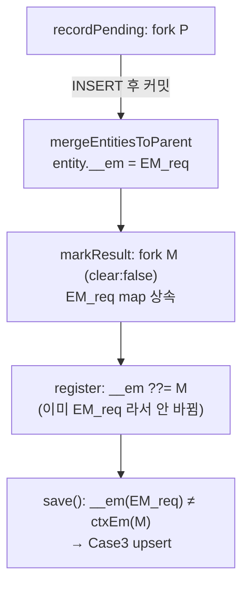

# 15. EM fork split — save()가 upsert로 빠지는 함정

> **핵심 질문**: 한 요청 안에서 두 개의 `@Transactional` 메서드가 같은 엔티티를 다룰 때, 두 번째 메서드의 `save()`는 왜 UPDATE가 아니라 upsert(INSERT)로 빠지는가?

실제 운영 사고에서 출발한 케이스다. SQS 컨슈머가 `recordPending`(원장 INSERT) → `markResult`(상태 UPDATE)를 순차 호출하는데, `markResult`의 `repo.save()`가 PostgreSQL에서 터졌다:

```
DriverException: cannot insert a non-DEFAULT value into column "id"
  (GENERATED ALWAYS as IDENTITY)
```

`save()`를 빼고 필드만 바꾸면(dirty-flush) 정상 UPDATE. `find` 전에 `em.clear()`를 넣어도 정상. **MySQL/단일 글로벌 EM 테스트로는 재현되지 않았다.** 왜?

## 15.1 재현 토폴로지 — 한 메시지가 거치는 EM 3개

`@EnsureRequestContext`가 요청마다 EM_req를 만들고, 그 안의 `@Transactional` 메서드는 각자 **새 fork**를 뜬다. REQUIRED 전파라 "트랜잭션이 있으면 올라탄다"지만, `recordPending`이 끝나면 그 트랜잭션은 **닫히므로** `markResult`는 올라탈 트랜잭션이 없어 또 fork한다.

```
EM_req (#4)   ← @EnsureRequestContext 가 만든 요청 전용 EM
   │
   ├─ recordPending  @Transactional  ──▶  fork P (#5)
   │      entity 생성 → INSERT
   │      커밋 시 mergeEntitiesToParent(P → EM_req)
   │      → entity.__em = EM_req(#4)      ← 소속이 EM_req 로 박힌다
   │
   ├─ (ME HTTP — 트랜잭션 밖)
   │
   └─ markResult     @Transactional  ──▶  fork M (#6)
          find(signature) → entity 반환  (소속은 여전히 EM_req #4)
          save(): ctxEm = M(#6),  entity.__em = #4
                  #4 ≠ #6  →  "남의 EM 소속" 오판  →  Case3 upsert
```

## 15.2 왜 `__em`이 어긋나는가 — v7 소스 3줄



`@mikro-orm/core` v7 내부 동작 (7.0.x 공통):

| 위치 | 코드 | 효과 |
|------|------|------|
| `TransactionManager.createFork` | `clear: options.clear ?? false` | fork가 부모의 identity map을 **상속** |
| `TransactionManager.mergeEntitiesToParent` | `helper(entity).__em = parent` | 커밋 시 엔티티 소속을 **부모(EM_req)로** 재지정 |
| `UnitOfWork.register` | `wrapped.__em ??= this.#em` | 상속받은 엔티티는 `__em`이 **이미 있으면 안 바꿈** → EM_req 유지 |

세 줄이 맞물려: recordPending이 엔티티를 EM_req 소속으로 만들고, markResult의 fork는 그걸 물려받지만 소속은 EM_req 그대로 → 현재 컨텍스트(M)와 어긋난다.

> **왜 단일 글로벌 EM 테스트로는 재현 안 됐나**: 두 `@Transactional`이 같은 EM에서 fork될 때도 split은 발생한다. 다만 MySQL은 `AUTO_INCREMENT` 컬럼에 explicit id INSERT를 **허용**하므로 upsert가 에러 없이 통과해버린다. 증상(에러)은 PostgreSQL `GENERATED ALWAYS`에서만 드러나고, **상태 분기 메커니즘 자체는 DB와 무관하게 동일**하다.

## 15.3 실측 — 상태 덤프 + 실제 SQL

`repro/` 레이어를 실제 MySQL에 연결해 EM 상태와 SQL을 찍었다 (`test/jpa-compat/15-em-fork-split-repro.spec.ts`, `src/jpa-compat/repro/run.ts`).

```
--- recordPending (ctxEm=fork P #5) ---
[STATE] create 직후   managed=undefined  hasPK=false  __em=null   → Case2 INSERT

--- markResult (ctxEm=fork M #6) ---
[STATE] find 직후     managed=true  hasPK=true  hasOriginalData=true  __em=#4  ctxEm=#6  → Case3 upsert
```

| 처리 방식 | markResult `find` | 저장 SQL | `updatedAt`(onUpdate 훅) | 결과 |
|-----------|-------------------|----------|--------------------------|------|
| `save()` 그대로 | `select … where signature=?` | `insert(id,…) ON DUPLICATE KEY UPDATE` | ❌ null | **PG IDENTITY 에러** |
| `em.clear()` + `save()` | `select … where signature=?` | `update … where id=?` | ✅ SET | 정상 (부작용 큼) |
| **`save()` 제거 (dirty-flush)** | `select … where signature=?` | `update … where id=?` | ✅ SET | **정상 · 권장** |
| `nativeUpdate` | (find 불필요) | `update … where signature=?` | ❌ null | 정상 (수동 보정 필요) |

## 15.4 오해 1 — "캐시에 있으면 SELECT가 안 나가야 하지 않나?"

**아니다. 네 방식 모두 `find`에서 SELECT가 나간다.** identity map(1차 캐시)은 **PK로만** 색인된다. `signature`는 PK가 아닌 자연키라, 이 값으로 찾으려면 **무조건 DB SELECT**가 필요하다.

SELECT로 행을 가져온 뒤 **PK로 캐시를 대조**하는데, 여기서 갈린다:

- `clear` 안 함: 캐시에 같은 PK가 이미 있음 → **낡은 인스턴스**(소속 EM_req) 반환 → save 오판
- `clear` 함: 캐시 비었음 → SELECT 결과로 **새 인스턴스**를 fork M에 hydrate → 소속 M → save 정상

즉 `em.clear()`의 효과는 "SELECT를 나가게 하는 것"이 아니라, **SELECT 결과가 어느 인스턴스(소속 EM)로 연결되는지를 바꾸는 것**이다.

## 15.5 오해 2 — "그럼 dirty-flush도 똑같이 깨져야 하지 않나?"

`markResult` 시점에 엔티티 소속은 여전히 EM_req(어긋남)인데, 왜 `save()`만 빼면 멀쩡한 UPDATE가 나가는가?

엔티티는 fork할 때 **M의 UnitOfWork에 register**됐다(`clear:false`). 커밋 시 flush는 **"내 UnitOfWork에 등록됐고 값이 바뀌었나"**(change-set)만 보고 UPDATE를 만든다 — 소속 포인터(`__em`)는 보지 않는다.

반면 `save()`는 **`__managed && __em === ctxEm` 포인터 일치**를 먼저 따지는데, 이 가드만 어긋나 upsert로 빠진다.

> **flush는 튼튼하고(UnitOfWork 멤버십 기반), save()의 가드만 깨지기 쉽다(`__em` 포인터 기반).** → [08. Dirty Checking](./08-dirty-checking.md) 참고.

## 15.6 수정 비교

### (A) `save()` 제거 — dirty-flush · **권장**

```typescript
@Transactional()
async markResult(transactionCode: string, status: Status): Promise<void> {
  const existing = await this.repo.findByTransactionCode(transactionCode);
  if (!existing) return;
  existing.status = status;
  existing.registeredAt = status === Status.SENT ? new Date() : null;
  // managed 엔티티 → @Transactional 커밋의 dirty-check flush(UPDATE).
  // save() 금지: __em 불일치(EM fork split)로 upsert → PG IDENTITY 에러.
}
```

변경 최소(한 줄 삭제), `onUpdate`/soft-delete 필터 모두 자동 유지, 관용적.

### (B) `nativeUpdate` — 구조적 면역, 단 수동 보정

```typescript
await this.em.nativeUpdate(Entity, { transactionCode, isDeleted: false },
  { status, registeredAt: new Date(), updatedAt: new Date() });
```

`nativeUpdate`는 UnitOfWork/identity map을 **아예 안 거쳐** fork split 문제에 구조적으로 면역이고 단일 UPDATE다. 대신:

- **`onUpdate` 훅 우회** — `updatedAt`이 자동으로 안 찍힌다 (실측 `null`). 데이터에 직접 포함해야 함.
- **WHERE를 직접 작성** — soft-delete partial unique index를 쓰면 `isDeleted: false`를 직접 챙겨야 함.

→ "ORM 상태머신을 의도적으로 우회한다"는 선택이면 valid. 일반적인 단건 상태 갱신에는 (A)가 더 적게 바뀌고 훅/필터를 공짜로 유지한다. → [10. 벌크 연산](./10-bulk-operations.md) 참고.

## 15.7 BaseRepository.save() 자체를 고친다면 — 조사 결과

위 (A)/(B)는 **사용처** 수정이다. 그렇다면 commons `BaseRepository.save()` **자체**를 고쳐 어떤 호출에도 안전하게 만들 수 있을까? MikroORM 공식 문서/이슈 조사 + 이 레포 실측 결과를 정리한다.

### upsert는 GENERATED ALWAYS PK에 설계상 맞지 않다 (버그 아님)

`em.upsert`의 `onConflictFields / onConflictMergeFields / onConflictExcludeFields` 옵션은 전부 **충돌 시 UPDATE 절만** 조정한다. INSERT 절은 여전히 PK(id)를 실어 보내 → Postgres `GENERATED ALWAYS`가 거부한다. 또한 v7에서 **upsert가 `onCreate`/`onUpdate` 라이프사이클 훅을 우회**하는 변경이 보고됐다([#7399](https://github.com/mikro-orm/mikro-orm/issues/7399), PR #7400). 즉 commons Case3의 `em.upsert(entity)`는 "detached 저장"을 upsert로 흉내 낸 **오용**이다.

### MikroORM 권장: detached 저장 자체를 피하라

[공식 문서](https://mikro-orm.io/docs/unit-of-work)는 RequestContext/fork로 **managed 엔티티만** 다루기를 권장한다 (load → 수정 → flush = dirty-flush). 우회 대안들은 모두 함정:

- `em.merge(entity)`: 재부착은 되지만 변경값을 적용하지 않는다(refresh=false 기본) → UPDATE 안 됨.
- `wrap(managed).assign(entity)`: **초기화 안 된 컬렉션에서 크래시**(`Collection not initialized`). 스칼라만 담은 payload 로 assign 해도 cross-EM dirty 추적이 까다롭다(이 레포 13-1 실측: UPDATE 누락).

### ✅ 깨끗한 commons-레벨 방법 — Case3가 아니라 Case1 가드를 고친다

버그의 본질은 "fork-split 엔티티의 `__em`이 부모(EM_req)를 가리켜 detached로 **오판**"되는 것이다. 그런데 그 엔티티는 `fork(clear:false)`로 **현재 EM의 UnitOfWork에 이미 등록**돼 있다(그래서 dirty-flush가 된다). 따라서 Case1 가드를 **포인터 동일성**이 아니라 **UoW 멤버십**으로 바꾸면 된다:

```typescript
// 기존: __em 포인터 비교 → fork-split 에서 깨짐
if (wrapped.__managed && wrapped.__em === em) return entity;

// 수정: "현재 EM 의 UnitOfWork 에 이 인스턴스가 있나" (멤버십)
const inThisUow =
  wrapped.hasPrimaryKey() &&
  em.getUnitOfWork().getById(this.entityName, wrapped.getPrimaryKey()) === entity;
if (wrapped.__managed && inThisUow) return entity;
```

이 레포 실측 (가드 수정 후 fork-split 버그 경로):

- `__em(EM_req) ≠ ctxEm(M)` 인데도 **UoW 멤버로 인식 → dirty-flush**
- 결과 SQL: upsert 가 아니라 **`update … where id=?`**
- **`updatedAt` SET** — dirty-flush 라 `onUpdate` 훅 작동
- assign 을 안 하므로 **컬렉션-안전**
- 진짜 detached(다른 EM, UoW 에 없음)는 그대로 Case3 로 → **기존 동작 보존**

→ Case3 merge 재작성(컬렉션 크래시 + cross-EM 난점)보다 훨씬 작고 안전한 수술이다. 다만 commons 전역 변경이므로 **전체 사용처 점검 + 회귀 매트릭스**를 동반한 별도 작업으로 가야 한다.

| 레벨 | 방법 | 평가 |
|------|------|------|
| 사용처 | dirty-flush | 최소·안전·관용적 ✅ |
| commons | **Case1 가드 = UoW 멤버십** | 검증됨·소규모·기존 동작 보존. 권장 |
| commons | Case3 upsert → merge(assign) | 컬렉션 크래시 + cross-EM 난점 ❌ |

> 출처: [MikroORM #7399 (upsert v7 동작 변경)](https://github.com/mikro-orm/mikro-orm/issues/7399) · [Unit of Work 문서](https://mikro-orm.io/docs/unit-of-work) · [UpsertOptions API](https://mikro-orm.io/api/core/interface/UpsertOptions) · [EntityManager merge/assign 문서](https://mikro-orm.io/docs/entity-manager)

## 15.8 결론

- **원인**: 한 요청 안 두 개의 `@Transactional`이 각자 fork를 뜨고, 그 사이 `mergeEntitiesToParent`가 엔티티 소속을 EM_req로 박아 → 두 번째 fork에선 "남의 것"으로 보인다.
- **증상**: `save()`가 Case3 upsert로 빠짐 → PG `GENERATED ALWAYS` id INSERT 거부. (MySQL은 explicit id 허용이라 안 터짐 → 단일 EM 테스트로 재현 실패했던 이유)
- **수정(사용처)**: `save()` 제거(dirty-flush)가 최선. `nativeUpdate`는 면역이지만 `updatedAt`·soft-delete를 수동으로 떠안아야 한다.
- **수정(commons, 별도)**: `save()` Case1 가드를 `__em` 포인터 → **UoW 멤버십**으로 바꾸면 fork-split을 근본 해결한다 (§15.7). upsert→merge 재작성은 컬렉션 크래시로 비권장.

## 재현 방법

```bash
npm run db:up                                          # MySQL 기동
npx vitest run test/jpa-compat/15-em-fork-split-repro.spec.ts   # SQL 단언 4/4
npx ts-node --transpile-only src/jpa-compat/repro/run.ts        # 상태 덤프 + SQL 콘솔 출력
```

- `src/jpa-compat/repro/ledger.repository.ts` — `@plug-link/commons` `save()`를 바이트 동일 복제(upsert Case3)
- `src/jpa-compat/repro/em-state.ts` — `__managed / __em / __originalEntityData / ctxEm` 상태 덤프 헬퍼
- `src/jpa-compat/repro/ledger.consumer.ts` — `@EnsureRequestContext`로 SQS 컨슈머 재현
